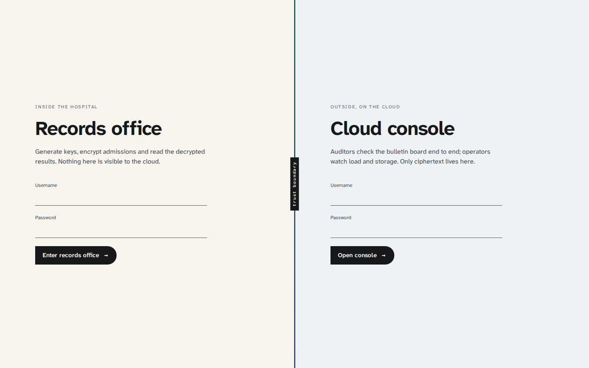

# E-Privacy — system overview

All project documentation lives in this one folder. The component files cover what the code does, how a request
moves through it, and the decisions behind it (options considered, what was chosen, pros and cons). The rest covers
the reasoning across components and how to run the system.

**Components**

| File | Component |
|---|---|
| [dataset.md](dataset.md) | The synthetic hospital admissions dataset and its generator |
| [shared-protocol.md](shared-protocol.md) | `shared/protocol.js`: the byte-level agreements between all parties |
| [cloud-service.md](cloud-service.md) | The untrusted cloud gateway and homomorphic compute engine |
| [owner-service.md](owner-service.md) | The trusted hospital agent (keys, encryption, verification, decryption) |
| [web-frontend.md](web-frontend.md) | The Vue 3 interface, charts and the in-browser auditor |
| [database.md](database.md) | MySQL schema and what is (and is not) stored |
| [docker-and-env.md](docker-and-env.md) | Containers, networks, volumes and environment variables |

**Running it**

| File | Topic |
|---|---|
| [DEVELOPMENT.md](DEVELOPMENT.md) | Local setup with hot reload, with and without Docker |
| [PRODUCTION.md](PRODUCTION.md) | Deploying, with and without Docker |

**Reasoning and evaluation**

| File | Topic |
|---|---|
| [architecture-decisions.md](architecture-decisions.md) | Decision records: context, options, choice, effectiveness, pros/cons |
| [problems-and-fixes.md](problems-and-fixes.md) | Problems hit during the build and how they were resolved |
| [security-analysis.md](security-analysis.md) | Requirement traceability, guarantees and residual risks |
| [performance.md](performance.md) | Measured timings, throughput and storage |
| [ui-design.md](ui-design.md) | Why the interface looks the way it does |
| [viva-questions.md](viva-questions.md) | Likely examiner questions with answers |



## 1. What the system does

A hospital (the *Data Owner*) wants aggregate statistics over sensitive admissions, such as mean length of stay per
department, readmission rates and bill distributions, computed on infrastructure it does not trust. The reports in
`../../Documents` require that:

- no plaintext measure ever exists outside the hospital (Confidentiality, SRS FR-1..FR-3),
- the cloud authenticates and authorises every request (FR-4),
- results are decrypted only inside the hospital (FR-5),
- every computation is logged tamper-evidently (FR-6), and both the hospital (*individual verifiability*) and any
  auditor (*universal verifiability*) can prove the result is complete and correct (Verifiability report),
- key length is configurable at 1024/2048/3072 bits (FR-7),
- operators can see throughput, latency and storage without seeing keys or data (FR-8).

## 2. Components and trust domains

```
┌──────────────────── hospital (trusted) ────────────────────┐   ┌─────────────────── cloud (untrusted) ───────────────────┐
│                                                             │   │                                                          │
│  hospital_admissions.csv (in the owner image only)          │   │   cloud  (Express, port 5000, internal)                  │
│        │                                                    │   │     auth.js    roles + sessions + query_log              │
│        ▼                                                    │   │     index.js   ingest, receipts, proofs, metrics         │
│  owner  (Express, port 4000, internal)                      │   │     compute.js Π cᵢ mod n², k-min policy                 │
│    dataset.js   reservoir sample of rows                    │   │     board.js   SHA-256 chain + ECDSA P-256 signatures    │
│    campaign.js  keygen → encrypt → spot-check → upload      │──►│        │                                                 │
│                 → verify receipt → query → verify → decrypt │◄──│        ▼                                                 │
│    pool.js + worker.js  Paillier on worker_threads          │   │   mysql 8.4 (cloud network only)                         │
│    /keys volume: private keys, own leaf hashes, receipts    │   │     users, sessions, campaigns, records, board, query_log│
└─────────────────────────────────────────────────────────────┘   └──────────────────────────────────────────────────────────┘
                     ▲                                                         ▲
                     │  /api/owner/*                               /api/cloud/*│
                     └──────────────────────  web (nginx + Vue)  ──────────────┘
                                         browser: owner pages, auditor worker, admin monitor
```

`shared/protocol.js` is imported by the owner, the cloud **and** the browser. It holds only public definitions and
arithmetic, so the auditor runs exactly the same hashing and verification code as the parties it is checking.

## 3. End-to-end flow of one campaign

1. **Sample.** The owner reads the CSV with a reservoir sample (uniform, without replacement) of *N* admissions.
2. **Keys (FR-1, FR-7).** A fresh Paillier keypair (`g = n + 1`) of the chosen length. The private half is written to the
   owner's `/keys` volume only. One key per campaign is the "rotation per analytics campaign" from the crypto design.
3. **Open campaign.** The public key `(n, g)` and the measure layout go to the cloud, which records them and appends
   `campaign_opened` to the board.
4. **Encrypt (FR-2).** Identifiers (name, NIC, date of birth, postcode, admission id) are dropped. Seven coarse dimensions
   stay in the clear for grouping. Each selected measure is fixed-point encoded, optionally with its square, and encrypted
   on a worker-thread pool.
5. **Spot-check.** 1 % of ciphertexts (min 5) are decrypted and compared with the source rows before upload
   (Verifiability §2.1 step 1).
6. **Upload.** Batches of 250 records. The cloud hashes each record into a Merkle leaf and returns the leaf hashes. The owner
   compares every one with its own.
7. **Commit (receipt).** The cloud builds the Merkle root, signs it and appends `batch_committed`. The owner checks the
   signature against its pinned key and the root against its own root. It keeps the receipt.
8. **Query (FR-3, FR-4).** The owner asks for a grouping + measures. The cloud multiplies ciphertexts per group
   (`E(a)·E(b) = E(a+b)`), withholds groups under `K_MIN`, and publishes `query_result` with the root and size of the
   input set it actually used.
9. **Verify and decrypt (FR-5).** The owner checks signature, board copy, root, count, decrypts every sum, recovers the
   Paillier randomness `r`, and recomputes the same sums from plaintext. Only if all five checks pass are the numbers shown.
10. **Publish proof.** `(m, r)` pairs are appended as `decryption_published`, so anyone can verify `gᵐ·rⁿ ≡ C (mod n²)`.
11. **Audit.** An auditor's browser replays the whole board: chain and signatures, Merkle roots from published
    ciphertexts, every product, every decryption.

## 4. Technology choices at a glance

| Concern | Choice | Why (short) |
|---|---|---|
| Frontend | Vue 3 + Vite + vue-router | requested; SFCs keep template, logic and scoped CSS together |
| Charts | Apache ECharts (tree-shaken, SVG renderer) | custom series for mean ± s.d. whiskers, heatmaps, accurate axes |
| Backend | Node.js 22 + Express 5 | requested; Express 5 forwards async errors without wrappers |
| Database | MySQL 8.4 | requested; `LONGBLOB` for packed ciphertext, `information_schema` for storage metrics |
| Paillier | `paillier-bigint` | reviewed library (crypto design assumption B1), native BigInt, exposes `getRandomFactor` |
| Hash / signatures | `@noble/hashes`, `@noble/curves` | audited, pure JS, identical in Node and the browser |
| Auth | `crypto.scrypt` + random bearer tokens | no extra dependency; sessions revocable in the DB |
| Packaging | one `docker-compose.yml`, one Dockerfile per service | requested |

Detailed trade-offs are in each component file and in [architecture-decisions.md](architecture-decisions.md).
