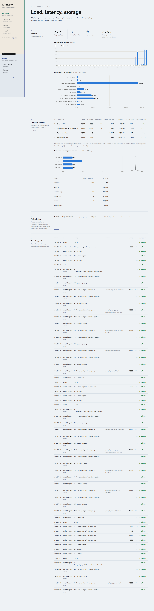

# Cloud service — `cloud/`

The untrusted side: an Express 5 app on port 5000 (reachable only on the internal Docker networks) backed by MySQL.
It holds public keys, ciphertext, coarse grouping labels and the bulletin board. It never receives a private key,
an identifier or a plaintext measure.

## Files

| File | Responsibility | SRS |
|---|---|---|
| `src/index.js` | routes: auth, board, campaigns, ingest, commit, proofs, query, decryption proofs, metrics, fault switch; startup | FR-3, FR-6, FR-8 |
| `src/auth.js` | scrypt password hashes, account sync from env, bearer sessions, `allow(...roles)` policy middleware, `query_log` | FR-4, Auditability |
| `src/board.js` | loads or creates the P-256 signing key, appends hash-chained signed entries, reads them | FR-6, V2, V3 |
| `src/compute.js` | homomorphic aggregation per group and column, k-min suppression, fault injection | FR-3, V4 |
| `src/db.js` | mysql2 pool and two tiny helpers | |

## API

| Method & path | Roles | What happens |
|---|---|---|
| `POST /auth/login` | public | scrypt check, 32-byte random token stored in `sessions` (TTL from env) |
| `POST /auth/logout`, `GET /me` | any | |
| `GET /board/key` | public | the board's P-256 public key |
| `GET /board?after=&limit=`, `GET /board/:seq` | any | board entries in order |
| `GET /campaigns`, `GET /campaigns/:id` | any | campaign metadata + ciphertext bytes |
| `POST /campaigns` | owner | store `(n, g)`, measure layout, source size; append `campaign_opened` |
| `POST /campaigns/:id/records` | owner | validate and insert ≤ 5,000 records; compute and return leaf hashes |
| `POST /campaigns/:id/commit` | owner | Merkle root over leaves in seq order; append signed `batch_committed` (the receipt) |
| `GET /campaigns/:id/records?after=&limit=` | any | paged dims + ciphertext, for rebuilding roots and sums (the admin runs the audit too) |
| `GET /campaigns/:id/records/:seq/proof` | owner, auditor | inclusion proof for one record |
| `POST /campaigns/:id/query` | owner | aggregate; append `query_result` |
| `POST /campaigns/:id/decryptions` | owner | append `decryption_published` with (m, r) pairs for a query entry |
| `GET /metrics` | admin | logs, per-minute traffic, per-endpoint latency, storage, table sizes |
| `PUT /admin/fault` | admin | `off` / `drop` / `tamper` |
| `GET /admin/tables` | admin | the six tables with approximate row counts |
| `GET /admin/tables/:name?offset=&limit=&campaign=` | admin | read-only page of one table (≤ 200 rows); ciphertexts cut to 48 bytes and board payloads to 400 characters; `pass_hash` and session tokens never selected; table names only from a fixed list |

## How a query is computed (`compute.js`)

1. Validate: group-by fields must be known dimensions (at most two), measures must be in the campaign.
2. Load all records of the campaign ordered by seq (`dims`, packed `cipher`, `leaf_hash`).
3. Group by the requested dimensions. For each record, split the blob into fixed-width ciphertexts and keep the
   wanted columns (the measure and, if present, its square).
4. For each group: `C = Π cᵢ mod n²` per column (`aggregate` from the shared module). Groups with fewer than `K_MIN`
   records are dropped and only counted as `suppressed`.
5. Return `{ root, total, group_by, metrics, k_min, suppressed, groups: [{ key, n, sums }] }`, where `root` and `total`
   describe **the records actually aggregated**, not the stored campaign. That is what lets the owner detect a dropped
   or extra record: an honest run over the full set reproduces the receipt root.
6. `index.js` appends it to the board (signed) with the compute time, and returns the entry.

## Decisions

### Role-based policy as a middleware factory
`allow('owner')`, `allow('auditor', 'owner')` etc. on each route: the policy is readable next to the route it guards.
The same middleware logs every decision (allowed / denied / error, user, role, action, records touched, ms) to
`query_log` via `res.on('finish')`, so logging can't be forgotten on a new route. Denials are logged with the reason.
*Alternative:* a central policy table keyed by path. Rejected: one more place to keep in sync.

### Sessions in the database, not JWTs
- **Pros:** revocable (logout deletes the row), expiry enforced by SQL, no signing key to manage, no extra dependency.
- **Cons:** one indexed lookup per request. Negligible here.

### Accounts from the environment
`syncUsers()` upserts the three accounts at start and re-hashes the password each time, so changing `.env` and
restarting is all it takes. No sign-up flow exists (and none is needed for a single-hospital deployment, SRS A2).

### Packed ciphertext per record (`LONGBLOB`)
- **Options:** one row per ciphertext (record × column), JSON array of hex, one packed blob per record.
- **Chosen:** one blob, fixed-width slots.
- **Why:** one row per record keeps inserts and scans simple; fixed width means slicing is arithmetic; the blob is exactly
  what gets hashed into the leaf. Hex/JSON would double the storage.
- **Con:** you can't query a single measure's ciphertext in SQL. The engine never needs to.

### Aggregation in the application, not SQL
MySQL has no modular big-integer multiply. Pulling the rows and multiplying with BigInt is the straightforward option.
`ponytail:` note in `compute.js`: it loads the whole campaign in memory (~13 KB/record at 2048 bits); past ~100k records
this should stream by seq range and fan out over worker threads (Paillier summation is embarrassingly parallel, NFR
Scalability).

### Board append serialised in-process
Appends go through a promise chain so two concurrent requests can't both read the same "last" entry. `seq` is the
primary key, so even with several replicas a fork would fail loudly. The `ponytail:` note says to switch to
`SELECT … FOR UPDATE` if the cloud is ever scaled out.

### Signing key on a volume
Generated once (`newSigningKey`) into `/var/lib/cloud/signing.key` (mode 600) on the `cloud_keys` volume, so it survives
rebuilds. If it changed, the owner's pinned key would no longer match and it would refuse results, which is the intended failure mode.

### k-min suppression (V4)
Groups below `K_MIN` (default 10) are withheld, and only their count is reported. That keeps "aggregate" from turning into
"one patient's value" when a group is tiny (e.g. Transfer admissions to Obstetrics ICU).

### Fault injection
`drop` removes the first record from every query's input; `tamper` squares one ciphertext (doubling that value).
It is admin-only, off by default and logged. It exists so the Verifiability report's promise ("the cloud can deviate,
but not silently") can be demonstrated rather than just asserted.

### Input validation at the trust boundary
Every write checks types and sizes: name length, key length in {1024, 2048, 3072}, hex public key, batch size ≤ 5,000,
exact blob length for the campaign layout, dimension strings ≤ 32 chars, `seq` a non-negative integer, `mode` in a fixed set.
All SQL uses placeholders. The JSON body limit is 64 MB (a 250-record batch at 2048 bits is ~4.5 MB).
