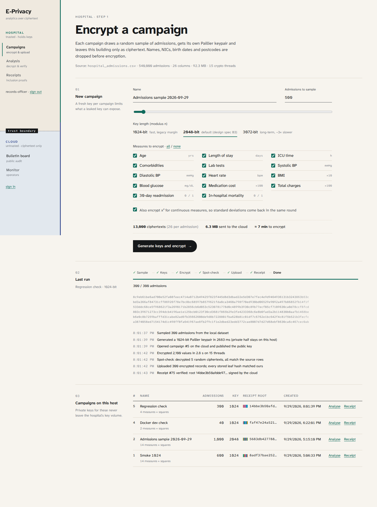
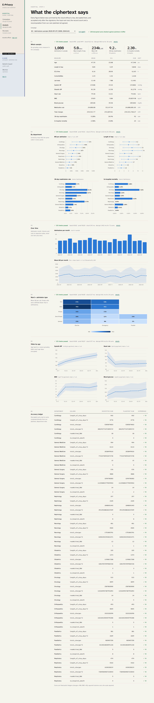

# Owner service — `owner/`

The trusted hospital agent: Express 5 on port 4000 (internal only). It is the only component that sees the dataset
and the private keys. It has no database credentials and talks to the cloud only through the cloud's public API,
with a service account.

## Files

| File | Responsibility | SRS / report |
|---|---|---|
| `src/index.js` | own sign-in (timing-safe compare against `.env`), in-memory sessions, routes, input validation | |
| `src/dataset.js` | streams the CSV: row count, reservoir sampling, reload of sampled rows by line index | |
| `src/campaign.js` | campaign job (sample → keys → open → encrypt → spot-check → upload → receipt), analysis, record check | FR-1, FR-2, FR-5, Verifiability §2.1 |
| `src/pool.js` | fixed pool of `worker_threads` (CPU count − 1), task queue, order-preserving `map` | NFR Performance |
| `src/worker.js` | runs `encrypt` and `decrypt` (+ `getRandomFactor`) with `paillier-bigint` | |
| `src/cloud.js` | cloud client with auto sign-in and retry on 401; trust-on-first-use pin of the board key | |

## API (behind `/api/owner` in nginx)

| Method & path | What happens |
|---|---|
| `POST /auth/login` | compare with `OWNER_USER` / `OWNER_PASSWORD` via SHA-256 digests + `timingSafeEqual` |
| `GET /dataset` | file name, rows, size, columns, measure catalogue, default key length, thread count |
| `POST /campaigns` | validate, start a background job, return it (202) |
| `GET /jobs`, `GET /jobs/:id` | progress: phase, done/total, rate, log lines, first ciphertexts |
| `GET /campaigns`, `GET /campaigns/:id` | local campaign state **without** key material |
| `GET /campaigns/:id/data` | the campaign's sampled rows as CSV, exactly as in the source file, re-read by line index (no copy is kept) |
| `POST /campaigns/:id/analyze` | query the cloud, verify, decrypt, compare with plaintext, publish proof |
| `GET /campaigns/:id/records/:seq/check` | fetch inclusion proof from the cloud and replay it against our own leaf and receipt |

## Where things are kept

`/keys/campaign-<id>.json` (mode 600, on the `owner_keys` volume) holds: the Paillier key (n, g, λ, μ, p, q in hex),
the measure layout, the line indexes of the sampled rows, all leaf hashes, and the verified receipt (root, count, board
seq, hash, signature) plus the pinned board key. `/keys/cloud-board-key.txt` is the TOFU pin. Plaintext rows are **not**
copied: they are reloaded from the CSV by line index when an analysis needs them, then cached in memory.

## The five checks before a result is accepted

`analyze()` builds this list and only returns numbers when every item is true:

| # | Check | Catches |
|---|---|---|
| 1 | entry hash recomputes and the signature verifies with the pinned key | forged or altered result |
| 2 | the entry fetched back from `GET /board/:seq` is identical | gateway returning something other than what was published |
| 3 | `payload.root` equals our receipt root | dropped, extra, substituted or re-labelled records |
| 4 | `payload.total` equals our record count | same, stated as a count |
| 5 | every decrypted sum equals our own plaintext recomputation | a tampered ciphertext inside the right input set |

Checks 1–4 are the Verifiability report's individual verifiability ("used in my query", "result as computed").
Check 5 is possible only because the hospital still holds the plaintext. It is also the **accuracy** measure shown in the
UI: with exact fixed-point integers the expected difference is 0, not "close to 0".

If everything passes, `(m, r)` for every sum is posted to the board so auditors can verify the decryption.

## Decisions

### Separate service instead of encrypting in the browser
- **Options:** (a) owner logic in the browser (keys in IndexedDB, Web Workers); (b) a separate Node service in the
  hospital network.
- **Chosen:** (b), agreed before implementation.
- **Why:** matches the SRS architecture ("Local Encryption Client" in the Data Owner domain); the key never touches a
  browser profile; the dataset never has to be uploaded into a browser; Node worker threads are faster and steadier than
  a browser tab. **Con:** one more container.

### Worker-thread pool
Paillier encryption is dominated by one modular exponentiation `rⁿ mod n²` (~44 ms at 2048 bits on the development
laptop, single thread). Rows are encrypted in chunks of 8 across `availableParallelism() − 1` workers so the event loop
stays responsive for progress polling. Decryption tasks are put at the **front** of the queue so an analysis isn't
stuck behind a long encryption job (problem log #12).

### Reservoir sampling
One pass, O(k) memory, uniform without replacement, output sorted back into file order. A prefix would be biased
(the file is generated in random order, but a real export would be sorted by date).

### Spot-check before upload
1 % of rows (minimum 5), first column, decrypted and compared with the encoded source. If the encryption library or its
randomness were broken, nothing is uploaded.

### Leaf-by-leaf upload check
The cloud returns the leaf hash of every stored record; the owner compares each with its own. A mismatch stops the
job at the batch where it happened, not at commit time.

### Pinning the board key (TOFU)
The first campaign fetches `GET /board/key` and stores it. Every later receipt and result must verify against that key.
`ponytail:` note in `cloud.js`: if the first contact itself can't be trusted, distribute the key out of band.

### Separate owner login
The hospital's user account has nothing to do with the cloud: the cloud's auth could be compromised without affecting
who can use the hospital's keys. The login compares SHA-256 digests with `timingSafeEqual` (equal-length buffers,
no early exit), and uses a non-short-circuit `&` so the time doesn't reveal which of username/password was wrong.

### What leaves the hospital, exactly
`POST /campaigns`: name, key length, n, g, measure layout, byte size of the sampled source rows.
`POST /records`: seq (0..N−1, not the admission id), seven dimension labels, packed ciphertext.
`POST /decryptions`: aggregate plaintexts and their randomness.
No names, NICs, birth dates, postcodes, admission ids, exact ages or per-record plaintext.
