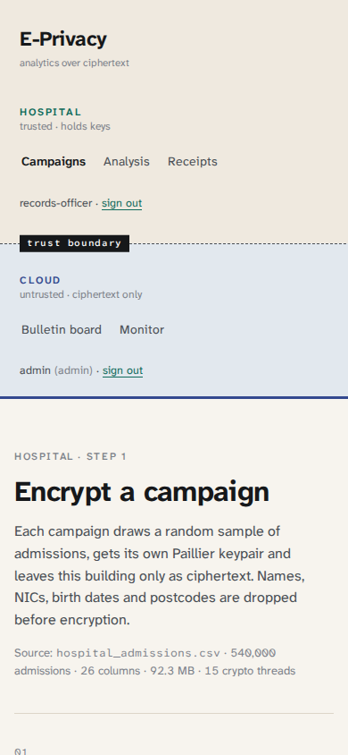

# UI design rationale

## The brief

Light theme. A new interface rather than the usual grid of cards with margins. Neat, accurate visualisation, which was
the reason the dataset was widened in the first place.

## The idea: make the trust boundary visible

The whole system is about *which side of a line* data is on. So the line became the layout:

- The navigation rail is painted in two halves: warm paper (hospital, trusted) above a dashed **trust boundary** marker
  and cool slate (cloud, untrusted) below it. The rail's edge is teal above and indigo below.
- The page background follows the side you're on. On a hospital page the whole page is warm; on a cloud page it
  cools. You never have to read a label to know whether you're looking at something the cloud can see.
- The sign-in page is literally split down the middle by the seam, one form per domain. Following a link that
  needs one domain dims the other half.

## Ledger instead of dashboard

Hospital records and audit logs are ledgers, so the pages are set like one:

- A narrow margin column carries the section number (`01`, `02` …), a short title and one sentence of explanation.
- Content sits to the right, uncontained. Sections are separated by a single full-width hairline and space.
- Tables have a heavy rule under the header and hairlines between rows, with no zebra striping, cell borders or boxes.
- Headline numbers are set large and separated by vertical hairlines, not placed in tiles.
- The board is a timeline: a vertical rule with a node per entry (filled for receipts, green-ringed for decryption proofs),
  expandable in place.
- The Merkle inclusion proof is drawn the same way, leaf at the top, root at the bottom, sibling hashes in between.

## Details

| Element | Treatment | Reason |
|---|---|---|
| Status | `✓ holds`, `✕ 2 failures`: glyph + word, coloured | never colour alone (accessibility, print) |
| Hashes | short hex + six-bar colour fingerprint | two roots can be compared at a glance; full value on hover |
| Inputs | underline only; 2 px accent underline on focus | no boxes; visible focus |
| Primary action | ink button with a tab-shaped right edge and an arrow that slides on hover | one clear action per section |
| Choices | underlined words (key length, fault mode) | lighter than segmented controls |
| Progress | phase list with ticks + a 3 px rule that fills | matches the ledger lines |
| Ciphertext "tape" | first ciphertexts fading out to the right in mono | shows what the cloud actually receives |

Typefaces: **Atkinson Hyperlegible Next** for everything, titles in bold; **Atkinson Hyperlegible Mono** for hashes,
ciphertexts and ids. The first choice (IBM Plex Sans + Newsreader + JetBrains Mono) was dropped in review because it
read as the generic "generated UI" combination. Atkinson was designed by the Braille Institute for legibility at low
vision, which fits a hospital records tool, and its slashed zero and clearly different 1 / l / I help when comparing hex.

## Charts

Colour follows the dataviz rules: one validated categorical palette, one colour per single-series chart, a single blue ramp
for the heatmap, status red only for "denied". No dual axes: the monthly view is two stacked charts sharing the month axis.
Spread is always shown where it's available (whiskers, bands), because a mean without spread is misleading for
skewed hospital bills.

## Accessibility

- Every chart container has `role="img"` and an `aria-label`; the numbers behind every chart also appear in a table
  (overall table, accuracy ledger) or as direct labels.
- Status never relies on colour; focus rings are visible on all controls; the progress rule is a `role="progressbar"`
  with values.
- Text contrast: ink `#16181a` and secondary `#4a4f55` on both paper tones are well above 4.5:1.

## What I'd do next

Dark mode (tokens are already in one place); a printable audit report; keyboard shortcuts on the board timeline.
