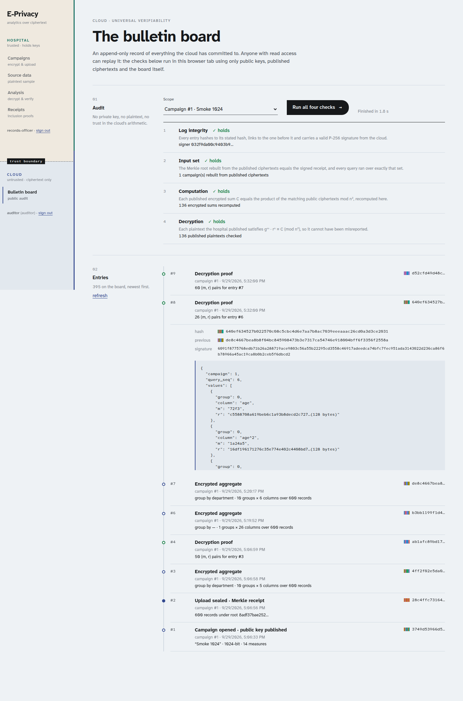

# Web frontend — `web/`

Vue 3 single-page app, built by Vite and served by nginx, which also reverse-proxies `/api/owner/*` → `owner:4000` and
`/api/cloud/*` → `cloud:5000`. It is the only published port.

## Files

| File | Responsibility |
|---|---|
| `index.html`, `src/main.js` | entry; Google Fonts (Atkinson Hyperlegible Next and Mono) |
| `src/App.vue` | the navigation rail split by the trust boundary; cloud links filtered to the signed-in role; page tint per domain |
| `src/router.js` | routes, per-domain and per-role guards, page titles |
| `src/api.js` | two independent sessions (`owner`, `cloud`), fetch wrapper, sign-in/out |
| `src/theme.css` | design tokens and the shared typographic system (sections, figures, ledger tables, marks, controls) |
| `src/charts.js` | ECharts registration (tree-shaken, SVG renderer) and the six chart builders |
| `src/components/EChart.vue` | mounts a chart, resizes with a `ResizeObserver`, disposes on unmount |
| `src/components/Hash.vue` | hash prefix + colour fingerprint of its first six bytes |
| `src/components/Checks.vue` | the owner's verification result for one query, expandable |
| `src/views/Login.vue` | two sign-in forms on either side of the seam; refuses the cloud service account with a message |
| `src/views/Campaigns.vue` | new campaign form, live job progress, campaign ledger |
| `src/views/Data.vue` | a campaign's plaintext sample, each column tagged encrypted / sent in clear / stays here; CSV download |
| `src/views/Analysis.vue` | five queries → figures, charts and the accuracy ledger |
| `src/views/Receipts.vue` | signed receipt and per-record inclusion proof path |
| `src/views/Board.vue` | the four universal checks, and the board as a timeline |
| `src/views/Monitor.vue` | operator figures, traffic, latency, storage expansion, fault switch, request log |
| `src/views/Database.vue` | admin's read-only view of the cloud's tables, paged, filterable by campaign |
| `src/audit.worker.js` | universal verification in a Web Worker |
| `nginx.conf`, `Dockerfile` | build stage with Node, runtime stage with nginx; `index.html` is `no-cache`, hashed `/assets/` are immutable and 404 when missing |

## Visual language

The brief was: light theme, no typical box/card layout, a new UI. The concept is **the trust seam**:

- The rail is physically split: hospital pages on warm paper above a dashed "trust boundary" marker, cloud pages on cool
  slate below it. The rail's right edge is teal above the boundary and indigo below. The page background changes
  tint to match the side you are on, so it is always visible which domain you are looking at.
- The sign-in page puts both domains side by side, separated by the seam.
- Content is set like a ledger rather than a dashboard: a numbered margin column (`01`, `02`, …) with a short heading and
  explanation, content to the right, and full-width hairlines between sections. No cards, panels, shadows or rounded boxes.
- Figures are large numerals separated by hairlines. Tables have rules only. Status is a glyph plus a word
  (`✓ holds`, `✕ 1 failure`), never colour alone.
- Inputs are underlines. The primary button is ink with a tab-shaped right edge and an arrow that slides on hover.
  Choice groups (key length, fault mode) are underlined words, not segmented boxes.
- Hashes are shown with a six-bar colour fingerprint so equal roots can be compared at a glance.
- Atkinson Hyperlegible Next for all text, with titles set bold rather than in a second typeface; Atkinson
  Hyperlegible Mono for hashes, ciphertexts and ids. The family was designed by the Braille Institute for low-vision
  readers, which suits a hospital tool, and its slashed zero and distinct 1/l/I make hex easier to compare.

## Charts: what and why

The `dataviz` guidance was followed: pick the form first, colour last; one series = one colour; no dual axes; validated palette.

| View | Chart | Reasoning |
|---|---|---|
| Department: bill, length of stay | horizontal **mean ± 1 s.d. whiskers** with value labels | a bar of the mean hides spread; the whisker shows the s.d. that the encrypted squares make possible |
| Department: readmission, mortality | horizontal bars, value-labelled | rates are magnitudes from zero; bars are right |
| All department panels | same category order (by mean bill) | lets the eye read across panels |
| Monthly | columns for admissions + a separate line with ± s.d. band for mean bill | two measures on different scales → two charts, never twin axes |
| Ward × admission type | heatmap, single blue ramp, value in each cell, white text on dark cells | two categorical axes, one magnitude |
| Vitals by age band | small multiples, line + s.d. band over ordered bands | ordered categories, trends across age |
| Monitor traffic | stacked columns, allowed = series blue, denied = status red (with legend) | status colour only for a status |
| Monitor latency / storage | horizontal bars; storage has a dashed SRS-budget reference line | comparison against a threshold |

Every chart has a hover tooltip (value first, label second), tooltips escape their text, and axes are recessive.
Suppressed groups (k-min) simply don't appear; the Checks line states how many were withheld.

**Accuracy.** The numbers shown are computed from exact integer sums: mean = Σ/n, s.d. from `n·Σx² − (Σx)²` in BigInt,
rates = Σflag/n. The accuracy ledger lists each decrypted sum next to the plaintext sum and the difference.

## The in-browser auditor (`audit.worker.js`)

Runs in a Web Worker so the UI stays responsive while it does thousands of big-integer operations. It uses the auditor's
token only to *read*; everything else is recomputed locally with the shared module:

1. fetch the board key and all entries → `verifyChain` (hash, link, signature of each);
2. per campaign: fetch all published records → rebuild leaves and root → compare with `batch_committed`;
   for each query, check that its input root and size equal the committed set;
3. per query group and column: recompute `Π cᵢ mod n²` from the published ciphertexts → compare with the published C;
4. per published plaintext: `gᵐ · rⁿ ≡ C (mod n²)`.

Progress and results stream back as messages; failures are listed individually.

## Decisions

- **Two separate sessions.** The hospital and cloud never share a token; signing out of one leaves the other. A cloud
  compromise can't be used to act as the hospital.
- **ECharts over Chart.js / hand-written SVG.** Custom series for whiskers, a real heatmap with a visual map, SVG output
  that stays crisp in screenshots. Tree-shaken to the six chart types used. **Con:** ~1 MB unminified library; lazy-loaded
  per route so the sign-in page doesn't pay for it.
- **No state library, no UI kit.** Views own their state; `api.js` has the only shared reactive object. The UI kit would
  have brought exactly the boxed look the brief ruled out.
- **Surviving a rebuild.** Vite names each page chunk by its content hash, so a tab opened before a rebuild asks for
  chunks that no longer exist. nginx answers those with 404 (not `index.html`), and `router.onError` reloads the target
  page once so the tab picks up the new build instead of silently staying put.
- **Light theme only.** Requested; dark mode wasn't built.
- **Responsive.** Below 900 px the rail becomes a top bar with horizontally scrolling links; sections stack; tables scroll
  inside their own container.
